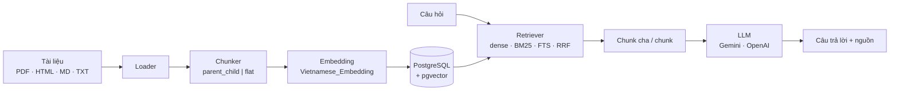

# RAG Assistant

Hệ thống hỏi đáp tiếng Việt dựa trên tài liệu của riêng bạn, xây theo mô hình **Retrieval-Augmented Generation**. Tài liệu (PDF, HTML, Markdown, văn bản thuần) được nạp, chia nhỏ, vector hóa và lưu vào PostgreSQL + pgvector. Khi có câu hỏi, hệ thống tìm các đoạn liên quan rồi nhờ LLM trả lời kèm nguồn trích dẫn.

[](https://github.com/tanh8805/rag-assistant/actions/workflows/ci.yml)


## Tính năng

- **Nạp tài liệu** qua API hoặc code: PDF (theo từng trang), HTML, Markdown, TXT.
- **Chống nạp trùng** bằng mã băm SHA-256 của nội dung file: file đã có (dù đổi tên) sẽ bị bỏ qua, file sửa nội dung sẽ thay bản cũ.
- **Hai chiến lược chia chunk** để so sánh: `parent_child` (tìm trên chunk nhỏ, trả về chunk cha giàu ngữ cảnh) và `flat` (chunk cố định). Mỗi chiến lược dùng một database riêng.
- **Bốn cách truy xuất**: dense (vector, cosine), BM25 (từ khóa, chỉ số giữ trong RAM), FTS (từ khóa bằng PostgreSQL Full-Text Search với GIN index) và RRF (kết hợp dense với BM25), có thể lọc theo tài liệu.
- **Hai LLM** chọn bằng cấu hình: Google Gemini hoặc OpenAI.
- **Bộ đánh giá** kèm theo: 40 câu hỏi có đáp án chuẩn và đoạn bằng chứng, đo Recall@k, MRR và số token đưa cho LLM, có và không rerank.

## Kiến trúc



| Thành phần | Công nghệ |
|---|---|
| API | FastAPI, Uvicorn |
| Cơ sở dữ liệu | PostgreSQL 16 + pgvector (HNSW, cosine), SQLAlchemy 2 + psycopg 3 |
| Embedding | `AITeamVN/Vietnamese_Embedding` (1024 chiều) qua sentence-transformers |
| Chia chunk | LangChain `RecursiveCharacterTextSplitter` |
| BM25 | `rank-bm25` (BM25Plus), chỉ số trong RAM |
| FTS | PostgreSQL Full-Text Search (`tsvector` + GIN index) |
| LLM | Gemini (`gemini-2.5-flash`) hoặc OpenAI (`gpt-4o-mini`) |

## Bắt đầu nhanh

**Yêu cầu:** Python 3.11+, Docker, và một API key của Gemini hoặc OpenAI. Có GPU NVIDIA thì embedding nhanh hơn nhiều nhưng không bắt buộc.

```bash
# 1. Cài thư viện
python -m venv .venv && source .venv/bin/activate
pip install -r requirements.txt

# 2. Cấu hình: điền POSTGRES_PASSWORD và GEMINI_API_KEY (hoặc OPENAI_API_KEY)
cp .env.example .env

# 3. Khởi động database (cổng 5432 phải đang trống); tự tạo rag_parent_child và rag_flat
docker compose up -d db

# 4. Chạy API
uvicorn src.main:app --reload
```

Nạp tài liệu và đặt câu hỏi:

```bash
curl -F "file=@tai_lieu.pdf" localhost:8000/ingest
curl -X POST localhost:8000/query -H "Content-Type: application/json" \
     -d '{"question": "Điều kiện để được xét học bổng là gì?"}'
```

Giao diện Swagger: http://localhost:8000/docs

> Lần nạp đầu tiên chậm vì phải tải và khởi tạo model embedding (khoảng 2 GB). Muốn chạy trên CPU, đặt `CUDA_VISIBLE_DEVICES=""` trước lệnh `uvicorn`.
> Service `api` trong `docker-compose.yml` cũng chạy được (`docker compose up -d`) nhưng build lâu, image lớn và chỉ dùng CPU; khi phát triển nên chạy `uvicorn` trực tiếp như trên.

## API

### `POST /ingest`

Upload một file (`.pdf`, `.md`, `.txt`, `.html`, `.htm`). File được lưu trong `data/uploads/`.

```json
{ "filename": "tai_lieu.pdf", "status": "ingested", "document_id": 1 }
```

`status` là `"duplicate"` (và `document_id` là `null`) nếu nội dung file đã có trong hệ thống. Định dạng không hỗ trợ trả về `400`.

### `POST /query`

| Trường | Kiểu | Mặc định | Mô tả |
|---|---|---|---|
| `question` | string | bắt buộc | Câu hỏi |
| `retriever` | `"dense"` \| `"bm25"` \| `"fts"` \| `"rrf"` | `"rrf"` | Cách truy xuất |
| `top_k` | int (1–100) | `20` | Số chunk lấy ra ban đầu |
| `document_ids` | int[] \| null | `null` | Chỉ tìm trong các tài liệu này; `null` là tìm tất cả |

```json
{
  "answer": "…",
  "sources": [{ "source": "data/uploads/tai_lieu.pdf", "content": "…" }]
}
```

Các chunk cha tìm được được cross-encoder (`rerank.model`) chấm điểm lại; `sources` là `rerank.top_n` chunk cha điểm cao nhất, cũng là phần được đưa cho LLM. Nếu không tìm thấy gì, API trả lời "không tìm thấy" mà không gọi LLM. Thiếu API key trả về `503`.

## Cấu hình

Cài đặt chung nằm trong [`config.yaml`](config.yaml); khóa bí mật nằm trong `.env`.

| Mục | Khóa | Ý nghĩa |
|---|---|---|
| `chunking` | `strategy` | `parent_child` hoặc `flat`; quyết định API ghi vào database nào |
| | `parent_size`, `child_size`, `child_overlap` | Kích thước chunk cha, chunk con và phần chồng lấn (parent_child) |
| | `chunk_size`, `chunk_overlap` | Kích thước chunk và phần chồng lấn (flat) |
| `retrieval` | `top_k` | Số chunk lấy ra mặc định |
| `rerank` | `model`, `top_n` | Model cross-encoder chấm lại và số chunk cha đưa cho LLM |
| `llm` | `provider` | `gemini` hoặc `openai` |
| | `gemini_model`, `openai_model` | Tên model |
| `embedding` | `model`, `dim` | Model embedding và số chiều vector |

Biến môi trường (`.env`): `POSTGRES_PASSWORD`, `GEMINI_API_KEY`, `OPENAI_API_KEY`.

## Dữ liệu và chiến lược chunking

Mỗi chiến lược có database riêng (`rag_<strategy>`) để so sánh công bằng mà không ghi đè lẫn nhau. Hai file SQL khởi tạo chỉ chạy khi volume `pgdata` còn trống; để làm lại từ đầu (xóa hết dữ liệu): `docker compose down -v && docker compose up -d db`.

Database tạo từ phiên bản cũ chưa có cột `content_tsv` và GIN index cho retriever `fts`. Thêm vào mà không mất dữ liệu (chạy cho cả `rag_parent_child` và `rag_flat`):

```sql
ALTER TABLE chunks ADD COLUMN IF NOT EXISTS content_tsv tsvector GENERATED ALWAYS AS (to_tsvector('simple', content)) STORED;
CREATE INDEX IF NOT EXISTS idx_chunks_fts ON chunks USING gin (content_tsv);
```

| | `rag_parent_child` ([`init.sql`](src/db/init.sql)) | `rag_flat` ([`init_1.sql`](src/db/init_1.sql)) |
|---|---|---|
| Bảng | `documents`, `parents`, `chunks` | `documents`, `chunks` |
| Embedding | chỉ chunk con (~600 ký tự) | mỗi chunk (~1000 ký tự) |
| Trả cho LLM | chunk cha (~1500 ký tự) chứa chunk con tìm được | chính chunk tìm được |

Cả hai đều có cột `embedding vector(1024)` với chỉ mục HNSW cosine. Nếu đổi model embedding, sửa `vector(1024)` trong hai file SQL và `embedding.dim` trong `config.yaml` cho khớp, rồi nạp lại dữ liệu.

**Đổi cấu hình chunking:** vì nạp trùng bị bỏ qua theo mã băm, sau khi đổi kích thước chunk cần xóa tài liệu cũ (`DELETE FROM documents`) rồi nạp lại.

## Đánh giá retrieval

Bộ dữ liệu thử nghiệm là *Sổ tay Sinh viên khóa D26* của Học viện Công nghệ Bưu chính Viễn thông ([nguồn](https://tsv.ptit.edu.vn/S%E1%BB%95%20tay%20sinh%20vi%C3%AAn%20D26.pdf), 268 trang). File PDF không nằm trong git; hãy tải về và đặt vào `data/`.

[`eval/golden.jsonl`](eval/golden.jsonl) có 40 câu hỏi: 28 câu có đáp án (loại `fact`, `procedure`, `multi_section`) và 12 câu không có đáp án trong tài liệu. Mỗi câu có đáp án kèm trang nguồn và `evidence_spans`, các đoạn trích nguyên văn từ tài liệu.

```bash
python -m eval.run_retrieval
```

Muốn đổi strategy, retriever hoặc các mức k, sửa các hằng số ở đầu [`eval/run_retrieval.py`](eval/run_retrieval.py). Cần nạp tài liệu vào database của strategy cần đánh giá trước.

### Cách tính

Chỉ đánh giá **context**, tức thứ thực sự đưa cho LLM:

- **parent_child:** retriever tìm trên chunk con (top 20). Mỗi chunk con được đổi thành chunk cha của nó, cha trùng bị bỏ và giữ thứ hạng của lần xuất hiện đầu tiên. Danh sách cha sau khi bỏ trùng là danh sách xếp hạng, nên **k tính trên số cha, không phải số chunk con**. Vì nhiều chunk con thuộc cùng một cha, 20 chunk con chỉ cho khoảng 16 cha (nhỏ nhất 12), nên Recall@20 thực chất là recall của toàn bộ danh sách cha đó.
- **flat:** danh sách xếp hạng là chính các chunk tìm được.
- **Đúng/sai:** một văn bản được coi là đúng nếu chứa nguyên văn một đoạn trong `evidence_spans`. Recall@k là tỉ lệ đoạn bằng chứng nằm trong top-k; MRR là 1 chia thứ hạng của văn bản đúng đầu tiên.
- **Rerank = có:** cross-encoder (`rerank.model`) chấm lại chính danh sách văn bản ở trên và xếp lại, không thêm bớt văn bản nào.
- **Token TB (top-5):** số token trung bình của 5 văn bản đầu danh sách (số văn bản mà `/query` đưa cho LLM), đếm bằng tokenizer của model embedding. Chỉ dùng để so sánh tương đối giữa các strategy, không phải số token thật của LLM.

### Kết quả

28 câu có đáp án; parent_child dùng parent 1500 / child 600 (541 cha, 1.254 chunk con), flat dùng chunk 1000 / overlap 100 (740 chunk).

| Strategy | Retriever | Rerank | Recall@1 | Recall@3 | Recall@5 | Recall@10 | Recall@20 | MRR | Token TB (top-5) |
|---|---|---|---|---|---|---|---|---|---|
| parent_child | dense | không | 0.562 | 0.798 | 0.857 | 0.946 | 0.967 | 0.811 | 1627 |
| parent_child | dense | có | 0.568 | 0.857 | 0.932 | 0.955 | 0.967 | 0.836 | 1399 |
| parent_child | bm25 | không | 0.628 | 0.711 | 0.771 | 0.866 | 0.911 | 0.796 | 1699 |
| parent_child | bm25 | có | 0.616 | 0.842 | 0.911 | 0.911 | 0.911 | 0.860 | 1519 |
| parent_child | fts | không | 0.524 | 0.649 | 0.771 | 0.795 | 0.866 | 0.711 | 1752 |
| parent_child | fts | có | 0.554 | 0.807 | 0.866 | 0.866 | 0.866 | 0.818 | 1591 |
| parent_child | rrf | không | 0.640 | 0.896 | 0.938 | 0.955 | 0.955 | **0.887** | 1638 |
| parent_child | rrf | có | 0.568 | 0.905 | 0.932 | 0.955 | 0.955 | 0.845 | 1452 |
| flat | dense | không | 0.473 | 0.789 | 0.869 | 0.914 | 0.967 | 0.787 | 1176 |
| flat | dense | có | 0.512 | 0.815 | 0.878 | 0.920 | 0.967 | 0.842 | 1146 |
| flat | bm25 | không | 0.533 | 0.735 | 0.771 | 0.839 | 0.857 | 0.762 | 1200 |
| flat | bm25 | có | 0.476 | 0.798 | 0.857 | 0.857 | 0.857 | 0.810 | 1156 |
| flat | fts | không | 0.440 | 0.664 | 0.729 | 0.795 | 0.830 | 0.665 | 1208 |
| flat | fts | có | 0.476 | 0.780 | 0.830 | 0.830 | 0.830 | 0.798 | 1193 |
| flat | rrf | không | 0.574 | 0.807 | 0.833 | 0.893 | 0.964 | 0.824 | 1181 |
| flat | rrf | có | 0.476 | 0.815 | 0.887 | 0.964 | 0.964 | 0.825 | 1143 |

- RRF không rerank cho kết quả tốt nhất: với parent_child, MRR đạt 0.887 và Recall@5 đạt 0.938 (flat: 0.824 và 0.833).
- FTS của PostgreSQL kém BM25 (parent_child: MRR 0.711 so với 0.796) vì `ts_rank` không tính độ hiếm của từ (IDF), nên các từ phổ biến như "là", "của" có sức nặng bằng từ khóa thật. Đổi sang `ts_rank_cd` hoặc bỏ từ quá phổ biến khỏi câu hỏi đều không cải thiện. Đổi lại FTS không tốn RAM và tự cập nhật khi ingest (chạy ~8 ms/câu trên 1.254 chunk, ngang BM25 trong RAM). RRF vẫn kết hợp dense với BM25.
- Rerank giúp nhiều nhất khi retriever ban đầu yếu: BM25 của parent_child tăng Recall@5 từ 0.771 lên 0.911 và MRR từ 0.796 lên 0.860; dense cũng tăng. Với RRF, rerank gần như không cải thiện (parent_child còn giảm MRR 0.887 xuống 0.845), và Recall@1 giảm ở hầu hết cấu hình dùng BM25 hoặc RRF.
- Rerank chỉ xếp lại danh sách đã tìm được nên Recall@20 không đổi. Token top-5 giảm khoảng 10% ở parent_child vì cross-encoder hay đưa các chunk cha ngắn lên đầu.
- parent_child đưa cho LLM nhiều token hơn flat khoảng 40% (~1.640 so với ~1.180 cho top-5, khi không rerank), nên cần cân nhắc phần chất lượng tăng thêm cùng chi phí này.
- Ở Recall@20 hai strategy gần như bằng nhau; ưu thế của parent_child nằm ở việc xếp đúng lên đầu.
- Chỉ có 28 câu hỏi, nên chênh lệch vài điểm phần trăm chưa đủ để kết luận chắc chắn.

## Cấu trúc thư mục

```
.
├── config.yaml              # cấu hình chung
├── docker-compose.yml       # Postgres + pgvector (và API)
├── eval/
│   ├── golden.jsonl         # bộ câu hỏi đánh giá
│   ├── metrics.py           # Recall@k, MRR
│   └── run_retrieval.py     # chạy đánh giá
├── src/
│   ├── main.py              # ứng dụng FastAPI, gom các router
│   ├── api/                 # ingest.py, query.py
│   ├── ingestion/           # loader PDF/HTML/MD/TXT, băm file, pipeline nạp
│   ├── chunking/            # parent_child, flat, factory
│   ├── embeddings/          # sentence-transformers
│   ├── db/                  # schema SQL, lưu chunk, kết nối
│   ├── retrieval/           # dense, BM25, FTS, RRF, factory
│   ├── rerank/              # cross-encoder chấm lại các chunk cha
│   └── generation/          # LLM Gemini/OpenAI, prompt, factory
└── tests/
```

## Kiểm thử

```bash
pytest
```
